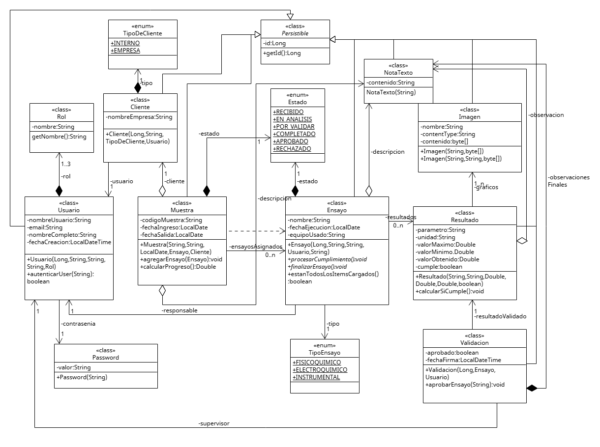
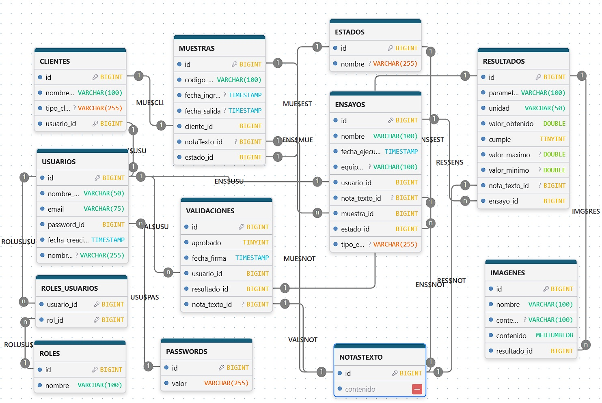

# LabHelper
Sistema de gestión de laboratorio para registrar, organizar y dar seguimiento al ciclo completo de análisis de muestras,ensayos y resultados.
---
**PROGRAMA INTENSIVO- CODIGO MARIANO**
---
## Sexta semana
### Objetivos

- [x] Implementar un manejo correcto de excepciones, diferenciando errores técnicos de errores de negocio. 
- [x] Diseñar y lanzar excepciones personalizadas cuando las reglas de negocio no se cumplen.
- [x] Validar datos de entrada de forma consistente y profesional. 
- [x] Comprender la importancia de testear antes de considerar "terminado" un desarrollo.
- [x] Escribir tests unitarios para validar la lógica de negocio.
- [x] Implementar tests de integración para verificar el comportamiento real del sistema dentro del contexto de Spring.
- [x] Pensar tu código en términos de calidad, mantenibilidad y confiabilidad.

### DIAGRAMA UML
**LabHelper_v6**

 

### DIAGRAMA BASE DE DATOS
Utilizando https://www.drawdb.app/. 

 